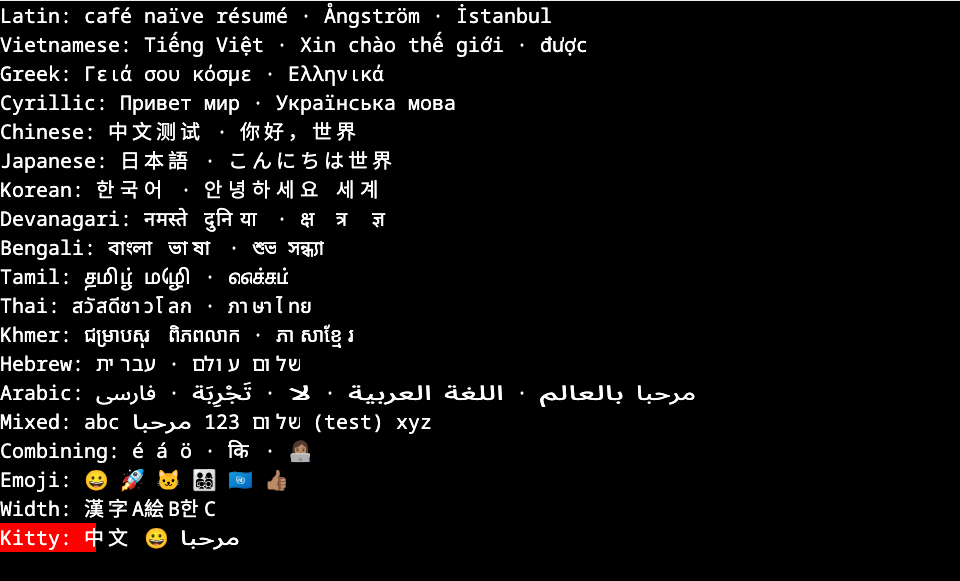

# ntwebterm — Ghostty terminal emulator for the browser

[](https://github.com/NimbleTerminal/ntwebterm/actions/workflows/ci.yml)
[](https://github.com/NimbleTerminal/ntwebterm/actions/workflows/build.yml)
[](./LICENSE)
[](https://nimbleterminal.github.io/ntwebterm/)

Ghostty’s terminal emulator in the browser, with an xterm.js-compatible API, WebGPU, WebGL and Canvas2D renderers, and Kitty graphics.

Part of the [Nimble Terminal](https://nimbleterminal.dev) family; formerly NimbleMarkets’ ghostty-web fork.
The browser layer originated in [Coder’s ghostty-web](https://github.com/coder/ghostty-web).

**[Try the live demos →](https://nimbleterminal.github.io/ntwebterm/)**

[Multilingual & BiDi](https://nimbleterminal.github.io/ntwebterm/?demo=multilingual) ·
[Colors & Styles](https://nimbleterminal.github.io/ntwebterm/?demo=colors) ·
[Box Drawing](https://nimbleterminal.github.io/ntwebterm/?demo=boxes) ·
[Kitty Graphics](https://nimbleterminal.github.io/ntwebterm/?demo=kitty) ·
[Scrollback & Input](https://nimbleterminal.github.io/ntwebterm/?demo=scrollback)

[](https://nimbleterminal.github.io/ntwebterm/?demo=multilingual)

_Browser screenshot from the [multilingual renderer checks](./bench/results/multilingual/README.md), using WebGPU at 20 px._
The hosted demos run entirely in your browser. For a real shell session, see the [local PTY demo](./demo/README.md).

## Comparison with xterm.js

xterm.js is everywhere—VS Code, Hyper, countless web terminals. But it has fundamental issues:

| Issue                                    | xterm.js                                                         | ntwebterm                  |
| ---------------------------------------- | ---------------------------------------------------------------- | -------------------------- |
| **Complex scripts** (Devanagari, Arabic) | Rendering issues                                                 | ✓ Proper grapheme handling |
| **XTPUSHSGR/XTPOPSGR**                   | [Not supported](https://github.com/xtermjs/xterm.js/issues/2570) | ✓ Full support             |

xterm.js reimplements terminal emulation in JavaScript. Every escape sequence, every edge case, every Unicode quirk—all hand-coded. Ghostty's emulator is the same battle-tested code that runs the native Ghostty app.

## Installation

```bash
git clone --branch built https://github.com/NimbleTerminal/ntwebterm.git
```

The `built` branch carries `dist/ntwebterm.js`, `dist/ntwebterm.d.ts`,
and `ghostty-vt.wasm`. Serve the runtime files together. npm publishing is
disabled until the new package is configured; the examples use its future package name.

## Usage

ntwebterm aims to be API-compatible with the xterm.js API.

```javascript
import { init, Terminal } from 'ntwebterm';

await init();

const term = new Terminal({
  fontSize: 14,
  theme: {
    background: '#1a1b26',
    foreground: '#a9b1d6',
  },
});

await term.open(document.getElementById('terminal'));
term.onData((data) => websocket.send(data));
websocket.onmessage = (e) => term.write(e.data);
```

For a comprehensive client <-> server example, refer to the [PTY demo source](./demo/index.html).

### Fonts and display scaling

The default size is 15 CSS pixels. The default family is
`"JetBrains Mono", "Cascadia Code", "Iosevka", "Source Code Pro", "ui-monospace", "SF Mono", Menlo, Consolas, monospace`.
Installed fonts determine which face is selected; no font is downloaded by default.
Existing `fontFamily` and `fontSize` overrides continue to work.

For predictable selection, serve an OFL JetBrains Mono WOFF2 asset with your app:

```typescript
const term = new Terminal({
  fontFamily: '"JetBrains Mono", monospace',
  fontFaces: [
    {
      family: 'JetBrains Mono',
      src: '/fonts/JetBrainsMono-Regular.woff2',
      weight: 400,
      style: 'normal',
      display: 'swap',
    },
  ],
});
await term.open(container);
```

Copy the font and its OFL license into your public assets first.
`fontFaces` accepts URL strings, CSS `url(...)` or `local(...)` sources, or an
array of sources in fallback order. Configure it before `open()`. Initial
measurement and paint wait for loading, up to three seconds. Failed or timed-out
faces fall back to the family stack; timed-out loads are not registered later.
Remote assets must permit cross-origin font loading.

Cell width and height round up to integer CSS pixels. Fractional DPR still
produces fractional device-pixel cell boundaries: renderers scale the backing
canvas while retaining the CSS grid. Font size, family, and display DPR changes
refresh metrics. `term.getFontMetrics()` returns cell width, height, baseline,
unrounded `advanceWidth`, `ascent`, and `descent` after opening.

### Renderers

Three GPU/CPU rendering backends are supported. Pass
`{ renderer: 'webgpu' | 'webgl' | 'canvas2d' | 'auto' }` (default `'auto'`) to the
`Terminal` constructor.

- **WebGPU** — preferred GPU backend with cached image textures
- **WebGL2** — fallback for browsers without WebGPU (notably Safari < 26 and
  Firefox without the flag); uses the same resolved image draw list
- **Canvas2D** — universal fallback; supports kitty graphics via 2D context

`'auto'` tries WebGPU → WebGL2 → Canvas2D in order, transparently falling
through to the next on init failure. At runtime, GPU device-loss (WebGPU) or
context-loss (WebGL) automatically demotes to the next available backend on
a fresh canvas.

All three backends use Ghostty's resolved Kitty image placements, including
fixed, relative and Unicode-placeholder images, source cropping and pixel offsets.
Images compose below cell backgrounds, below text or above text according to their
layer and z-index. Contiguous placeholder strips are merged when their geometry
allows it; they no longer use a 256-image shader lookup table.

Image generations control pixel uploads independently of placement changes.
Animation wakes the renderer at Ghostty's next frame deadline, respects synchronized
output and stops scheduling when playback stops or the terminal is disposed.
Off-screen decoded images/textures are evicted; each decoded-image cache is capped
at 64 MiB. Images exceeding that budget may be omitted until resources are available.
Legacy custom render buffers without `getImageFrame()` retain the older graphics path.

Run `bun run dev` and open [the renderer checks](./demo/kitty-renderer-check.html)
for real-browser layer and animation checks across all three backends.

### Unicode and bidirectional text

`Terminal.unicode.activeVersion` reports Unicode 15.1 for Ghostty's terminal,
grapheme, and width behavior. Implicit right-to-left ordering currently uses
[`bidi-js` 1.0.3](https://github.com/lojjic/bidi-js), whose generated tables
implement Unicode Bidirectional Algorithm 13.0. Characters assigned after
Unicode 13 may therefore have outdated BiDi classifications. Matching Unicode
15.1 requires those tables to be updated upstream in `bidi-js`.

A real-browser multilingual check covers representative Latin, Greek, Cyrillic,
CJK, Indic, Southeast Asian, RTL, combining-mark and emoji text across all three
renderers. Arabic words use contextual run shaping while preserving terminal
cell geometry. The check also covers Kitty image compositing. Open
`demo/multilingual-renderer-check.html` through
the Vite server, or see [the browser-test instructions](./bench/results/multilingual/README.md).

## Extensions

- **OSC 7501:** structured program status, exposed through `onProgramStatus`.
- **Program effects:** OSC 52 clipboard, OSC 7 working directory, OSC 9/777
  notifications, OSC 9;4 progress, OSC 133 shell integration, CSI 8 t resize
  requests and CSI ? 996 n color-scheme queries, parsed by libghostty-vt and
  exposed as events (see below).
- **Cell-anchored overlay addon / OSC 7502:** planned, not included in 0.4.0.

### Program effects (clipboard, pwd, notifications, prompts)

libghostty-vt parses these sequences; ntwebterm only adds the browser-facing
action and an event the host can hook. Events fire after the `write()` that
carried the sequence returns, so listeners may write or dispose freely.

| Sequence                         | Default behavior                                           | Event / option                                                       |
| -------------------------------- | ---------------------------------------------------------- | -------------------------------------------------------------------- |
| OSC 52 / 5522 clipboard write    | Copies the text to the browser clipboard                   | `onClipboardWrite`; `clipboardWrite: 'browser' \| 'event' \| 'deny'` |
| OSC 52 `?` / 5522 clipboard read | Refused, so programs can never read the clipboard silently | `clipboardRead: (request) => string \| null` (synchronous)           |
| OSC 7 / 9;9 / 1337 CurrentDir    | Stored; nothing else                                       | `onPwdChange`, `term.pwd`                                            |
| OSC 9 / OSC 777 notification     | Nothing is shown                                           | `onNotification`; `forwardNotificationsToBrowser()`                  |
| OSC 9;4 progress                 | Nothing is drawn                                           | `onProgress`                                                         |
| OSC 133 shell integration        | Nothing                                                    | `onSemanticPrompt`                                                   |
| CSI 8 ; rows ; cols t            | The terminal is not resized                                | `onResizeRequest`                                                    |
| CSI ? 996 n color scheme         | Answered from `theme.background` luminance                 | `colorScheme: 'auto' \| 'light' \| 'dark'`                           |

```typescript
import { Terminal, forwardNotificationsToBrowser } from 'ntwebterm';

const term = new Terminal({
  clipboardWrite: 'browser',
  // Serve OSC 52 reads from a value the host controls; omit to refuse reads.
  clipboardRead: (request) => (request.mimes.includes('text/plain') ? lastCopiedText : null),
});
term.onPwdChange((pwd) => updateTabTooltip(pwd));
term.onSemanticPrompt((e) => {
  if (e.kind === 'command-end' && e.exitCode) flashTab();
});
term.onResizeRequest(({ rows, cols }) => term.resize(cols || term.cols, rows || term.rows));
// Reference implementation: show browser notifications when permission is granted.
forwardNotificationsToBrowser(term, { requestPermission: false });
```

`clipboardRead` runs synchronously inside the VT stream, so it cannot await
`navigator.clipboard.readText()`; it is meant for host-controlled values such as
the text the host last copied. `forwardNotificationsToBrowser` never prompts
unless `requestPermission: true` is passed, and even then it only asks once.

### Paste

Paste is libghostty-vt's, not ours: `term.paste()` and clipboard paste events
call `ghostty_terminal_paste()`, which frames the text for bracketed paste
(mode 2004), converts newlines to carriage returns when unbracketed, replaces
control bytes such as ESC with spaces so clipboard contents can never end a
bracketed paste early, and sends a Kitty paste event (mode 5522) instead of the
text when the program asked for one and a `clipboardRead` handler is installed.

Upstream also flags pastes that could inject commands: a line terminator
outside bracketed paste, or the bracketed paste end marker. ntwebterm pastes
them by default, as xterm.js does; set `allowUnsafePaste: false` to drop them or
pass a callback to confirm with the person using the terminal:

```typescript
const term = new Terminal({
  allowUnsafePaste: (text) => window.confirm(`Paste ${text.split('\n').length} lines?`),
});
```

The low-level `GhosttyTerminal.paste(text, { allowUnsafe, source, location })` returns
`'pasted'`, `'empty'` or `'rejected'` and queues the PTY bytes for `readResponse()`.

### Mouse reporting

Mouse reports are encoded by libghostty-vt's mouse encoder
(`ghostty_mouse_encoder_*`). It reads the tracking mode (X10, normal, button,
any-event) and the output format (X10, UTF-8, SGR, urxvt, SGR-pixels) from the
terminal, drops events the mode does not report, and deduplicates motion within
a cell. TypeScript only turns the DOM event into a cell, a button and modifiers:
hit-testing uses the renderer's fractional cell metrics and BiDi visual-to-logical
mapping, and the encoder receives a pixel position inside that cell so SGR-pixels
(mode 1016) keeps the pointer's offset. Modifier bits follow xterm: Shift adds 4,
Alt/Option 8 and Ctrl 16. Wheel reports buttons 64/65 vertically and 66/67
horizontally.

`GhosttyTerminal.encodeMouse(report)` exposes the encoder for custom input
pipelines; `MouseEncoder` is the raw binding.

### Program status (OSC 7501)

Subscribe to structured program-status reports from applications:

```typescript
const subscription = term.onProgramStatus((report) => {
  console.log(report.state, report.app, report.message, report.progress);
});
// Later, stop receiving reports:
subscription.dispose();
```

`ProgramStatusReport` is exported from `ntwebterm`. Its `state` is `idle`,
`working`, `done`, `blocked`, `error`, or `clear`; `kind` is `permission`,
`question`, `auth`, or `null`. Progress is a percentage or `null`. The `id`,
`app`, `title`, and `message` fields are strings; title and message are already
decoded from base64 to UTF-8.

Subscriptions may be created before `open()`. The terminal answers OSC 7501
support queries only while at least one listener is subscribed. Reports arrive
synchronously during `write()`, after WASM parsing finishes. Support replies list
the accepted states and kinds (OSC 7501 revision 0.4). The host application
owns the status records: inherit an omitted `app` from the nearest ancestor,
replace each record by `id`, remove a cleared id and its
descendants, and clear everything for a `clear` report with an empty id. Both RIS
and `term.reset()` emit that full clear. The host must also apply the protocol's
process-exit lifetime rules; the browser terminal cannot detect PTY process exits.

The Ghostty submodule is pinned to **libghostty-vt 1.0.0** (tag `vt-1.0.0`,
`0fa3d577a5614150ff8e2c152de5fb9d5c6d2dec`, November 6, 2026).
Rebuilding requires Zig **0.17.0**; use
`ZIG=/absolute/path/to/zig bun run build` if your system compiler differs.

### Library version and build info

The terminal reports which libghostty-vt it runs on, so bug reports can say so:

```typescript
term.ghosttyVersion; // "1.0.0" (ghostty_version())
term.ghosttyBuildInfo; // ghostty_build_info(): { version, major, minor, patch, pre, build,
//   optimize: 'release_small', simd: false, features: { kittyGraphics: true, renderState: true, ... } }
```

Both are also available on `Ghostty` (`ghostty.version`, `ghostty.buildInfo`) before any
terminal is created. The submodule is pinned to the `vt-1.0.0` release tag, so the value
should match the version in the README unless you built the WASM yourself.

### Upstream libghostty-vt 1.0.0 sync

`vt-1.0.0` is the first stable libghostty-vt release: upstream now freezes the
C ABI (option enums, callback payload structs and the type manifest) and gates
non-additive changes in CI, so future syncs should need far fewer binding
updates. Compared with the v1.4.0 pin, this release changed the ABI as follows:

| Upstream change                                                                                                                    | Effect on ntwebterm                                                                                                                                         |
| ---------------------------------------------------------------------------------------------------------------------------------- | ----------------------------------------------------------------------------------------------------------------------------------------------------------- |
| Every option/data enum gains an `_INVALID = 0` sentinel, shifting most values by one                                               | `TerminalOption`, `SysOption`, `KeyEncoderOption`, `RenderStateOption`, `RenderStateRowOption` and the Kitty iterator option were renumbered in `types.ts`. |
| `ghostty_key_encoder_setopt*` renamed to `ghostty_key_encoder_set*`; `ghostty_key_event_set_utf8` takes a `GhosttyString` by value | Bindings renamed; the UTF-8 text is passed as an 8-byte `{ ptr, len }` struct.                                                                              |
| `GhosttyKey` adds `FN` (146) and renames keys (`DIGIT_*`, `ARROW_*`, `NUMPAD_*`, `BACKQUOTE`)                                      | `Key` values from `FN_LOCK` onward shifted by one; `Key` now uses the upstream names and keeps the old ones (`KP_*`, `GRAVE`, ...) as deprecated aliases.   |
| Callback payload structs drop their `size` prefix (`GhosttyTerminalProgramStatus`, `GhosttyGridRef`, `GhosttySelection`, ...)      | OSC 7501 program status and grid-reference decoding use the new offsets.                                                                                    |
| `GhosttyStyle` is a frozen 16-byte struct: 4-byte `GhosttyStyleColor` values and a `GhosttyStyleFlags` bitfield                    | Cell style decoding reads the flags word and 1-byte color tags instead of the old 72-byte struct.                                                           |
| `GRAPHEMES_BUF` takes a `GhosttyCodepointBuffer { ptr, cap, len }`                                                                 | Viewport grapheme reads pass a descriptor; the old bare-pointer call silently returned nothing.                                                             |
| Kitty image data keys `DATA_PTR`/`DATA_LEN` become `PIXELS` (a `GhosttyString`) and `EXPECTED_LEN`                                 | `getKittyImagePixels()` reads the string pair and treats `GHOSTTY_NO_VALUE` as "not yet loaded".                                                            |
| The placement iterator's layer filter is a `GHOSTTY_IMAGE_LAYER_MASK_*` bitmask                                                    | `KittyGraphicsPlacementLayer` is now a mask; `KittyGraphicsImageLayer` mirrors `GhosttyImageLayer`.                                                         |
| `SCROLLBACK_MAX_BYTES` with a NULL value restores the 10,000-byte default instead of removing it                                   | The byte budget is lifted with `SIZE_MAX`, so `scrollbackLimit` keeps meaning lines.                                                                        |
| `cursorDownScroll` zeroes recycled rows upstream                                                                                   | Our recycled-row clearing hunk was dropped from the patch; `viewport-corruption.test.ts` still guards the behavior.                                         |

The browser shared-memory hook in `patches/ghostty-wasm-api.patch` now also
registers `GhosttySysReadSharedMemoryFn` in upstream's type manifest, which the
1.0 build requires for every option that takes a callback.

#### Generated ABI bindings

Nothing about the C ABI is mirrored by hand any more. `scripts/gen-ghostty-abi.ts`
reads upstream's frozen manifest (`ghostty/src/terminal/c/abi/wasm32-freestanding.json`)
plus the patch's additions (`patches/ghostty-wasm-api.abi.json`) and writes
`lib/ghostty-abi.ts`: every `Ghostty*` enum, the bit fields of packed types such
as `GhosttyStyleFlags`, and a `*Layout` constant with the size and field offsets
of every struct. `lib/types.ts` re-exports the enums under ntwebterm's names and
`lib/ghostty.ts` decodes callback payloads through the layouts.
`lib/ghostty-abi.test.ts` fails when the generated file is stale, when the built
WASM's own `ghostty_type_json()` disagrees with manifest + extensions, or when a
declared export is missing from upstream's `symbols.txt` or the binary. To sync
to a new upstream tag: bump the submodule, `bun run build:wasm`, `bun run gen:abi`,
then `bun test`.

See the [upstream comparison](https://github.com/ghostty-org/ghostty/compare/v1.4.0...vt-1.0.0)
and the [vt-1.0.0 C API headers](https://github.com/ghostty-org/ghostty/tree/vt-1.0.0/include/ghostty/vt)
for the complete API changes.

### Upstream v1.4.0 sync

Compared with our previous October 6 pin (`a4aacd918`), this release brings:

| Change                                                                                           | Availability in ntwebterm                                                                                                                                                                         |
| ------------------------------------------------------------------------------------------------ | ------------------------------------------------------------------------------------------------------------------------------------------------------------------------------------------------- |
| OSC 7501 revision 0.4: capability lists in support replies, stricter record IDs                  | Active through `onProgramStatus`; the host owns ancestor `app` inheritance.                                                                                                                       |
| CSI 19 t screen-size reports and DECXCPR extended cursor reports                                 | Handled by WASM through existing response routing. CSI 19 t uses the text-area dimensions.                                                                                                        |
| DECSTR soft reset, tab-stop clearing, pending-wrap, grapheme reflow, selection and history fixes | Included in the updated terminal core.                                                                                                                                                            |
| Unified render-state image iterator                                                              | New upstream API resolves fixed, relative and Unicode-placeholder Kitty placements, with geometry, layers and placement generations. All three renderers consume this list, including scrollback. |
| Kitty animation tick                                                                             | New upstream API advances frames and returns the next redraw deadline; deadline-driven browser animation scheduling is enabled.                                                                   |
| Kitty graphics in snapshots                                                                      | Upstream snapshots now preserve images, placements and animation state, with progressive pixel loading. No public TypeScript snapshot wrapper yet.                                                |
| Prompt-based viewport navigation                                                                 | Upstream adds a prompt-delta scroll mode; no public TypeScript method yet.                                                                                                                        |
| CSI 8 t window-resize callback                                                                   | Upstream exposes resize requests to the embedder; no browser callback is installed.                                                                                                               |
| Bounded VT parsing                                                                               | `ghostty_terminal_vt_write_until` replaces `ghostty_terminal_vt_write_until_ground`, adding APC, DCS and OSC boundaries. Our normal write path is unchanged.                                      |

The existing browser graphics/shared-memory and recycled-row patch applies
unchanged. The build now uses Zig 0.17.0 and `-Doptimize=small`; CI and the Nix
compiler pin follow that version. `ghostty-vt.wasm` and `dist/` are generated,
git-ignored outputs, rebuilt locally and in CI.

See the [upstream comparison](https://github.com/ghostty-org/ghostty/compare/a4aacd918ba9e79929ff608034c60a4341773ef0...v1.4.0)
and [v1.4.0 C API headers](https://github.com/ghostty-org/ghostty/tree/v1.4.0/include/ghostty/vt)
for the complete API changes. The upstream OSC command enum also renames
`CONTEXT_SIGNAL` to `HIERARCHICAL_CONTEXT` without changing its numeric value;
our TypeScript bindings do not use that enum member.

### Renderer HUD

A small corner badge that shows the active renderer backend and live FPS,
with click-to-cycle and `Alt+Shift+R` cycling between renderers. Useful for
demos and during development; opt-in.

```javascript
import { init, Terminal, installRendererHud, parseRendererFromURL } from 'ntwebterm';

await init();
const term = new Terminal({ renderer: parseRendererFromURL() });
await term.open(document.getElementById('terminal'));

const uninstall = installRendererHud(term, {
  parent: document.getElementById('terminal'),
  position: 'absolute',
});
// later: uninstall();
```

`parseRendererFromURL()` reads `?renderer=webgpu|webgl|canvas2d|auto` from
the current URL and falls back to `window.__ghosttyDefaultRenderer` if a
server has injected one, then `'auto'`.

`installRendererHud(terminal, opts?)` options:

| Option             | Default                         | Description                                                |
| ------------------ | ------------------------------- | ---------------------------------------------------------- |
| `parent`           | `document.body`                 | Where to mount the badge.                                  |
| `position`         | `'fixed'`                       | `'fixed'` (viewport) or `'absolute'` (relative to parent). |
| `className`        | —                               | CSS class applied to the badge for custom styling.         |
| `clickToToggle`    | `true`                          | Click the badge to cycle the renderer.                     |
| `bindToggleHotkey` | `true`                          | Bind `Alt+Shift+R` on `window` to cycle the renderer.      |
| `cycle`            | `['webgpu','webgl','canvas2d']` | Cycle order; pass a subset to skip backends.               |

The toggle navigates `window.location.href` with the new `?renderer=` value,
so the page reloads with the chosen backend.

## Browser Kitty shared memory

After a terminal is constructed, `globalThis.ghosttyKittySharedMemory` is a
`Map<string, Uint8Array>`. Its presence signals support for browser `t=s`
transmissions. Put tightly packed, straight-alpha RGBA bytes in the map under a
unique name, then send a Kitty command containing the base64-encoded name:

```js
const name = '/ntc-example-frame'; // use a unique name for every pending frame
const pixels = new Uint8Array([255, 0, 0, 255]); // one red pixel
const registry = globalThis.ghosttyKittySharedMemory;
if (registry) {
  registry.set(name, pixels);
  term.write(`\x1b_Ga=T,t=s,f=32,s=1,v=1,S=4,i=7,c=1,r=1,q=2;${btoa(name)}\x1b\\`);
}
```

The terminal copies and deletes the entry while processing the command. Missing
names and invalid sizes fail without a response when `q=2`. Buffers must match
`S` exactly, or the format-derived size when `S` is absent; this browser hook
reads whole objects and rejects non-zero `O` offsets. Normal Kitty pixel-format
and dimension validation still applies. Producers must remove entries for frames
they discard before writing the command.

Ship the matching JavaScript bundle and `ghostty-vt.wasm` together. This registry
is a browser convention; it does not create operating-system shared memory.
The global name is preserved for compatibility. Moving it behind an option or
addon is future work.

## Development

ntwebterm builds from Ghostty's source with a [patch](./patches/ghostty-wasm-api.patch) to expose additional
functionality.

> Requires Zig and Bun.

```bash
bun run build
```

Mitchell Hashimoto (author of Ghostty) has [been working](https://mitchellh.com/writing/libghostty-is-coming) on `libghostty` which makes this all possible. The patches are very minimal thanks to the work the Ghostty team has done, and we expect them to get smaller.

This library will eventually consume a native Ghostty WASM distribution once available, and will continue to provide an xterm.js compatible API.

## Repository and releases

The full source history from `NimbleMarkets/ghostty-web` is preserved here,
including Coder’s commits. We pushed to the already-created empty repository
instead of transferring the fork: issues and the fork relationship remain at
[the original repository](https://github.com/NimbleMarkets/ghostty-web).
`main` continues `nm-kitty-meow` at `547ae5c`. Merged development branches are
preserved as `archive/*` tags; `built` is the only artifact branch. The
`build-artifacts` workflow rebuilds it on main pushes, daily, or on demand.
Consumers pin its commit, and must ship JavaScript and WASM from the same build.
Coder’s existing `v0.4.0` tag is preserved as `archive/coder-v0.4.0`; ntwebterm’s
`v0.4.0` identifies this rename. npm publishing is disabled until configured.

Booba’s next minor release serves `static/ntwebterm/ntwebterm.js` and keeps
`static/ghostty-web/ghostty-web.js` as a re-export for that minor release.
Consumers should update imports with their booba dependency bump; the alias is
scheduled for removal in the following release. This includes gloss,
ntfilepicker, nt3d, ntmaps, and thinkt. The overlay addon is subsequent work.

### Ghostty naming

Ghostty’s [project documentation](https://ghostty.org/docs/about) encourages
other terminals built on libghostty. A review of its README, CONTRIBUTING,
PACKAGING, and website documentation on 2026-10-31 did not locate a specific
published derivative-name policy. We do not claim naming approval: ntwebterm
uses its own product name and credits Ghostty as its emulator, with no implied
affiliation. Ghostty core identifiers and `ghostty-vt.wasm` retain their names.

## Open Collaboration

Contributions and feedback are welcome.
[Report an issue](https://github.com/NimbleTerminal/ntwebterm/issues) or
[submit a pull request](https://github.com/NimbleTerminal/ntwebterm/pulls).
See [AGENTS.md](./AGENTS.md) for development workflows and required checks.

## Acknowledgements

Thank you to [Ghostty](https://github.com/ghostty-org/ghostty) and its contributors
for the terminal emulator, and to [Coder](https://github.com/coder/ghostty-web)
for the original browser wrapper. Nimble Terminal develops this browser layer independently.

## License

[MIT License](./LICENSE). Copyright (c) 2025 Coder and (c) 2026 Neomantra Corp.

---

Made with :heart: and :fire: by the team behind [Nimble Terminal](https://nimbleterminal.dev).
